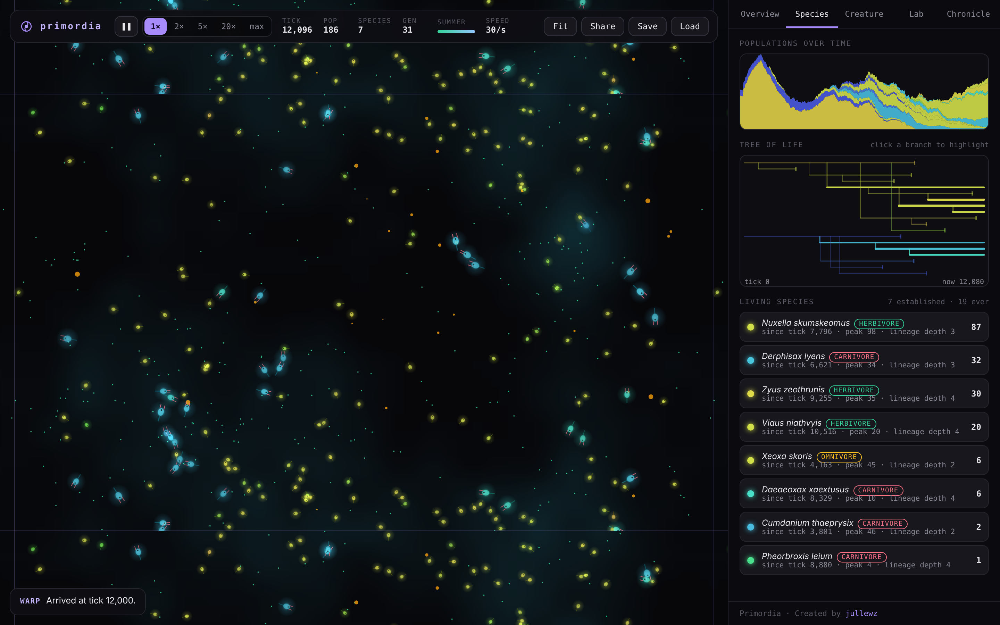
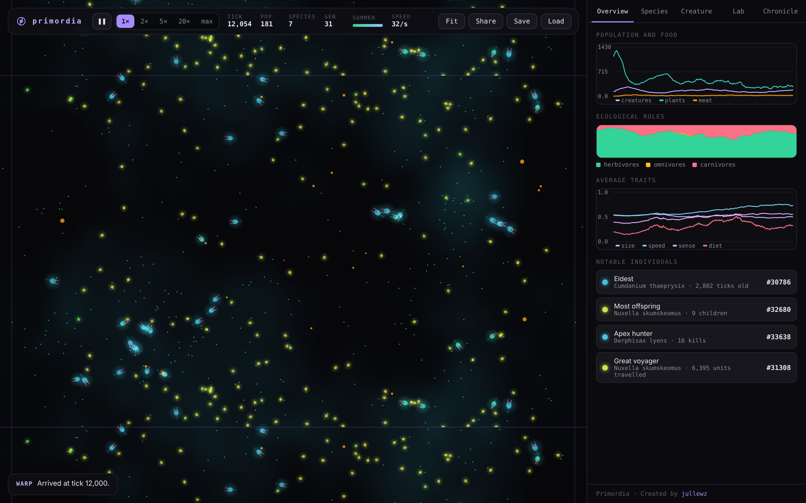
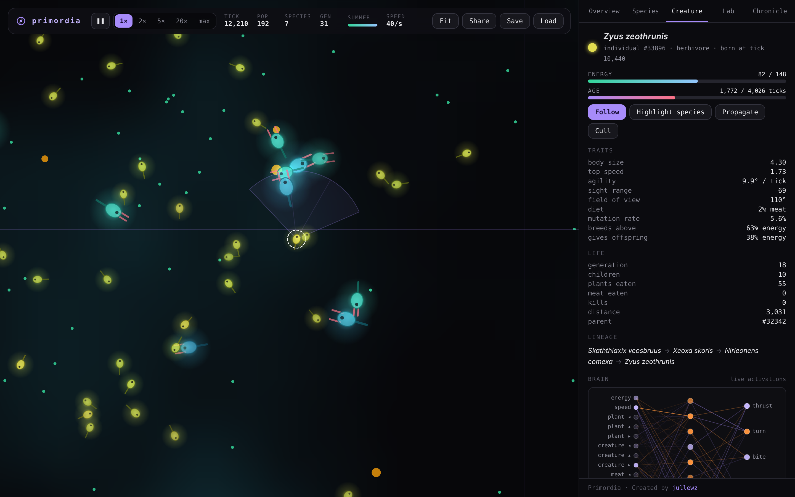

<div align="center">

# ◉ Primordia

**An artificial-life laboratory in your browser.**

Hundreds of creatures with genomes and neural-network brains eat, hunt, breed and mutate.
Nobody scripts their behaviour. Natural selection writes it.

[](https://github.com/jullewz/primordia/actions/workflows/ci.yml)


[](LICENSE)



</div>

---

## What this is

Primordia is not a game and has no goal. It is a small universe you observe.

Every creature carries a **genome** of 247 numbers: 11 genes for its body (size, speed, eyesight, diet, even its
own mutation rate) and 236 weights for a **neural network** that turns what it senses into movement, biting and
breeding. Children inherit mutated copies. Those that find food and avoid being eaten leave more children. That is
the whole algorithm, and it is enough for herds, ambush predators, population booms and mass extinctions to appear
on their own.

You get the instruments of a field biologist: a live **tree of life**, population streams, an inspector that shows
any creature's genes and its **brain firing in real time**, and a written **chronicle** of the world's history.

## Highlights

| | |
|---|---|
| **Evolving brains** | 16 senses → 10 hidden neurons → 6 actions, with two memory neurons and an internal clock. Weights are genes |
| **Evolving bodies** | Size, speed, agility, sight range, field of view, diet, colour, breeding strategy and mutation rate all evolve, with real trade-offs (big is strong but hungry) |
| **Ecology** | Plants grow on fertile land with seasons. Herbivores graze, carnivores hunt or scavenge, corpses become meat |
| **Speciation** | Lineages that drift far enough apart become new species with generated Latin-style names. Extinctions are recorded |
| **Tree of life** | A phylogeny of every established species, drawn live. Click a branch to highlight its members in the world |
| **Inspector** | Click any creature: traits, life story, ancestry and a live diagram of its neural network |
| **Chronicle** | "A new predatory species branches off…", "Population crash: 240 to 91…", written as it happens |
| **Lab controls** | Meteor strikes, droughts, ice ages, radiation, predator invasions, a food brush and live sliders |
| **Reproducible** | Same seed, same history. Share a world as a link. Save and load complete worlds |
| **Headless mode** | Run experiments from the terminal at thousands of ticks per second |

## Screenshots

<table>
<tr>
<td></td>
<td></td>
</tr>
<tr>
<td align="center"><sub>Population, roles and average traits over time</sub></td>
<td align="center"><sub>Following one creature: genes, life story and live brain</sub></td>
</tr>
</table>

These are captures of a real world (`seed=darwin`, tick 12,000). Reproduce them with `node scripts/screenshots.mjs`.

## Run it

You need [Node.js](https://nodejs.org) 20 or newer. It works the same on Windows, macOS and Linux.

```bash
git clone https://github.com/jullewz/primordia.git
cd primordia
npm install
npm start
```

Then open <http://127.0.0.1:5173/>. To open a specific world, add a seed: `http://127.0.0.1:5173/#seed=darwin`.

### Put it online

The repository includes a GitHub Pages workflow. After you push to `main`, enable **Settings → Pages → Source:
GitHub Actions** once, and the site deploys itself. To host it anywhere else, run `npm run site` and upload the
`site/` folder.

## Using the lab

| Action | How |
|---|---|
| Pan and zoom | Drag the world, scroll to zoom, `0` to fit |
| Inspect a creature | Click it, or press `R` for a random one. `F` follows it |
| Time | `Space` pauses, `1` to `5` set the speed (`5` runs as fast as your machine allows) |
| Highlight a species | Click it in the Species tab, in the tree of life, or in the chronicle |
| Change the world | Lab tab: events, live sliders, food brush, meteor tool |
| Share | **Share** copies a link with the seed and preset. Add `&warp=20000` to arrive at tick 20,000 |
| Keep a world | **Save** downloads a JSON file that **Load** restores exactly |

### Things to try

- Let a world run to tick 30,000, then open the **Species** tab and trace the tree of life.
- Trigger an **ice age** and watch which body plans survive the famine.
- Find the **apex hunter** in the Overview tab, follow it, and watch its brain light up when prey enters its view.
- Drop a **meteor** on the most crowded region and see what radiates into the empty land.
- Open the same seed on two machines and compare: the histories match.

## Headless experiments

```bash
npm run build
node dist/src/cli/run.js --seed darwin --ticks 12000 --report 3000 --save darwin.json
```

```
seed "darwin"  world 1600x1000  preset balanced
      tick    pop  plants  species   gen   size  speed   diet   herb  omni  carn
      3000     99     654        2     9   5.66   1.85  0.280     72     0    27
      6000    189     476        2    12   5.28   1.80  0.214    154     0    35
      9000    103     486        4    24   5.69   1.84  0.349     66     0    37
     12000    184     545        5    30   5.74   1.88  0.319    124     0    60
```

`--set KEY=VALUE` overrides any setting, `--json` prints a machine-readable summary, `--load` continues a saved
world, and `--settings` lists every setting with its range.

## How it works

```
 src/core   rng.ts · math.ts · config.ts          seeded randomness, torus math, validated settings
 src/sim    genome.ts · brain.ts · creature.ts    genes, neural network, bodies
            world.ts                              the tick loop: sense → think → act → live or die
            species.ts · history.ts               speciation, phylogeny, statistics, chronicle
            spatial.ts · noise.ts · serialize.ts  neighbour search, fertility map, save files
 src/ui     main.ts · renderer.ts · charts.ts     canvas rendering, panels, charts, tree of life
 src/cli    run.ts                                headless runner
```

The simulation core has no DOM access and no dependencies, so the same code runs in the browser and in Node, which
is how the test-suite checks it. One tick:

1. Seasons and events set how fast plants grow. Plants appear on fertile land, meat decays.
2. Each creature senses three sectors of its vision cone for plants, meat and other creatures.
3. Its brain turns those 16 inputs into thrust, turning, biting and breeding.
4. Moving, sensing and simply being large cost energy. Eating restores it. At zero energy a creature dies.
5. A creature with enough energy breeds. The child's genome is a mutated copy, sometimes crossed with a mate's.
6. A child too different from its species' founder starts a new species.

Details: [docs/simulation.md](docs/simulation.md) · [docs/genome.md](docs/genome.md) ·
[docs/architecture.md](docs/architecture.md) · [docs/experiments.md](docs/experiments.md)

## Development

```bash
npm install
npm run watch        # recompile on change
npm run serve        # in another terminal: http://127.0.0.1:5173
```

## Testing

```bash
npm test             # 43 tests on the simulation core and the CLI
npm run typecheck    # strict TypeScript
npm run format:check # Prettier
```

The tests cover determinism (two worlds from one seed stay identical), save/load continuity (a restored world has
the same future as the original), ecological invariants over long runs, genetics, the neural network, speciation
and the command-line runner.

## Honest limitations

- Worlds are reproducible on the same JavaScript engine. Different engines may round `Math.sin` and friends
  differently, so a seed can diverge between, say, Chrome and Firefox after many ticks.
- The simulation runs on the main thread inside a per-frame time budget. Very large worlds lower the tick rate
  rather than freezing the page.
- Brains have a fixed shape. Weights evolve, the wiring diagram does not (see the roadmap).
- The browser UI is verified by scripted screenshots, not by an automated UI test-suite.

## Roadmap

- [ ] Evolving network topology (NEAT-style neuron and connection genes)
- [ ] Web Worker simulation for higher tick rates
- [ ] Terrain: water, barriers and climate zones
- [ ] Sound and pheromone signalling between creatures
- [ ] Export the tree of life as Newick, and statistics as CSV
- [ ] Time-lapse replay of a saved world

## Contributing

Ideas, experiments and pull requests are welcome. See [CONTRIBUTING.md](CONTRIBUTING.md) and
[CODE_OF_CONDUCT.md](CODE_OF_CONDUCT.md).

## License

[MIT](LICENSE). Copyright © 2026 jullewz.

## Creator

**Primordia** is created by **[jullewz](https://github.com/jullewz)**.

Designed, developed and maintained by jullewz.
